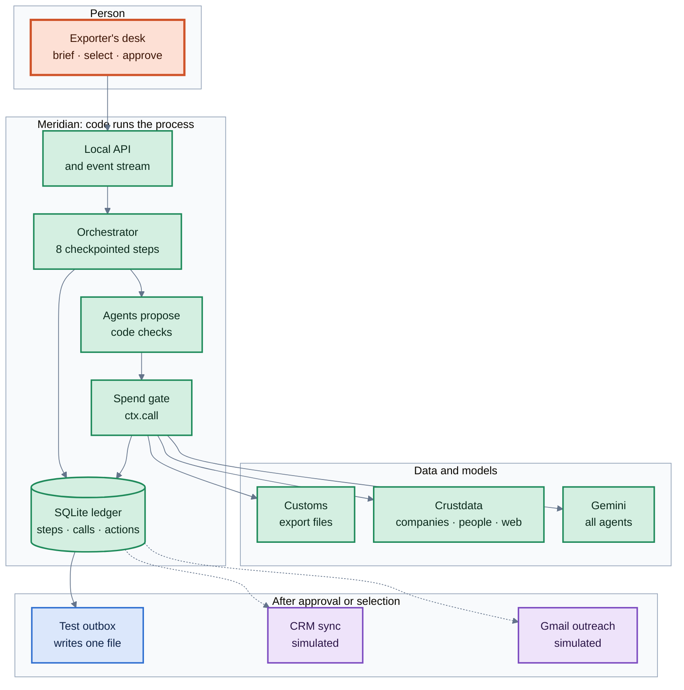
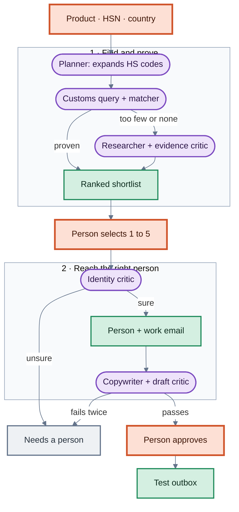
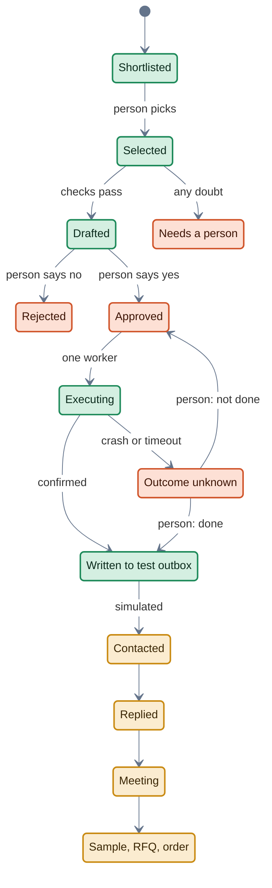
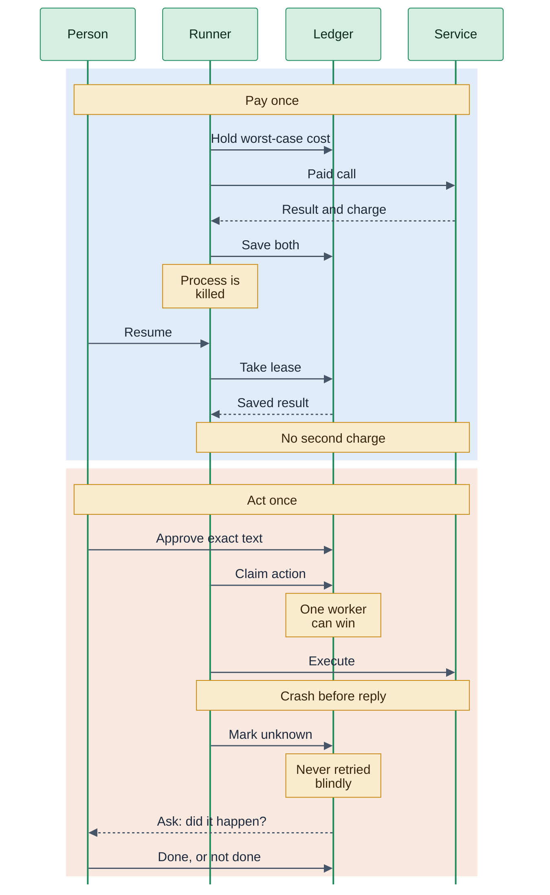

# Meridian Buyer Desk

**Meridian drives revenue for export businesses via distribution intelligence.**

*An agentic export sales desk for export businesses, built at ContextCon 05 (Crustdata × Y Combinator, BITS Pilani, 22 November 2026).*

Give it a product, an HSN code and a target country. It finds companies abroad that import or use that exact product, shows the evidence for each one, waits for you to choose, finds the person who decides and their work email, writes an email from that buyer's evidence, checks it, and waits for your approval.

The repository is called `tradescout` because the product grew out of that codebase during the day. The current product is on the branch [`pivot/agentic-buyer-desk`](https://github.com/shivanshpilani/tradescout/tree/pivot/agentic-buyer-desk). It was merged into the team's repository, [Jeevannnn20/tradescout](https://github.com/Jeevannnn20/tradescout), at 6:23 PM. The fork's `main` still holds the earlier, rules-only version.

**Contents:** [1. The service explained](#1-the-service-explained) · [2. What it does now](#2-what-it-does-now) · [3. What comes next](#3-what-comes-next) · [4. How it runs](#4-how-it-runs) · [5. What we tried](#5-what-we-tried) · [6. Why this way](#6-why-this-way)

### How to read the status labels

Every capability in this document carries one of these labels. Status is as of 6:27 PM IST on 22 November 2026, at commit [`384c82c`](https://github.com/shivanshpilani/tradescout/commit/384c82c).

| Label | Meaning |
|---|---|
| **Live** | Ran today against the real service (Crustdata, Gemini or a real customs export). |
| **Built, tested offline** | The code is on this branch and its tests pass. We are not claiming a live run of that specific case. |
| **Built, simulated** | The code works against a fake version of the outside service. It has not touched the real one. |
| **Being built** | In progress or on another branch. It is not part of this branch's product yet. |
| **Roadmap** or **Coming soon** | Not available in the product yet. |

In short: **the agents, Crustdata, the customs-file route, the ledger and the caps are live. CRM sync and outreach are built and tested on simulators, with no real send claimed. The redesigned interface is merged, and some of its screens still show example data. Other CRMs are coming soon. Buyer intelligence is Feature 2.**

---

## 1. The service explained

### The problem, without the jargon

Imagine applying for a PhD abroad without knowing which labs have funding, which professor decides, or whether they work on your topic. You could write to 500 professors and hear nothing, or spend weeks researching ten.

That is export sales for manufacturers around the world. A factory can make the product. What it doesn't know is:

1. **Who abroad buys this exact product**, and not merely something in the same category?
2. **Is there proof?** A company website saying "chemicals" doesn't show that the company buys menthol crystals.
3. **Who inside that company decides?**
4. **What can we truthfully say to them?**
5. **How do we approach them without spamming, or emailing our own customer by mistake?**

Four terms appear throughout this document:

| Term | Plain meaning |
|---|---|
| HS or HSN code | The number customs uses to classify a product. One code often covers several different products. |
| Customs or shipment record | A record that a shipment moved: who received it, from whom, what it was and when. |
| Importer or consignee | The company that received the shipment. |
| RFQ | A request for quotation: the moment a buyer asks for a price against a specification. |

### The service we replace

This work is done today by people, slowly and in pieces. Here is what it takes to find one good buyer by hand:

1. **Guess the customs codes.** The product may be declared under several, and each covers other products too.
2. **Export and read shipment records.** Where a country publishes them, they show who received a shipment, from whom, when, and often how much. Someone reads hundreds of free-text descriptions to see which are really this product.
3. **Clean up the company.** The receiver may be a freight forwarder, a misspelling, or one branch of a group. Someone has to work out which real company it is.
4. **Research markets with no records**, through tenders, projects, distributors' sites and approved-vendor lists.
5. **Find the person.** Who runs purchasing or sourcing there, do they still work there, and what is their work email?
6. **Write something true and specific**, check that it isn't an existing customer, get it approved, and follow up.

Every step needs a different tool and some judgement. Repeat it for every buyer, product and country, and it becomes a full-time job that most factories don't have anyone to do.

| What exporters use today | What they get | What is missing |
|---|---|---|
| Export agent or buying house | A person who brings enquiries, paid by commission | The exporter doesn't see the research or own the pipeline |
| Export consultant | A one-off market report | A report doesn't write to anyone |
| Trade-data subscription | Shipment rows to search | Someone still has to judge fit, find the person and write |
| B2B portal | Inbound enquiries shared among many sellers | Many are price comparisons |
| Contact database | Names and emails | No proof that the company buys this product |
| Export sales hire | All of the above, done manually | Slow, and only as broad as one person's week |

**What was built today, and what came before.** Before this hackathon we delivered this on a **service model**: people did the research and judgement, using trade-data subscriptions, contact tools and our internal sending and tracking tools. Today we built the software that does the job end to end, from a product and HSN code to evidence, the decision-maker and an email awaiting approval. The agents, pipeline and product in this repository did not exist before today.

### Who pays

- **Customer:** a manufacturer or export business with a product that can be specified (chemicals, ingredients, engineering parts, steel, packaging) that wants to sell directly to users and distributors abroad.
- **Champion:** the export or business-development manager.
- **Signs:** the owner or director.
- **When they buy:** a trade fair, a new target market, or a wish list of accounts that has stalled.

### Why we picked it

**This is an identified and validated pain point. Over 50 companies across South and Southeast Asia, the Middle East, Africa, Europe and Latin America have engaged with us on it, and we have already generated revenue from it. We have seen it first-hand, and we are confident it exists.**

To test demand, Meridian sent more than 17,000 emails to manufacturers offering this service, with about a 1.3% hard-bounce rate on addresses verified as valid before sending. The company count is the founders', as of 22 November.

### How we know the approach works: a case study

Meridian began inside a co-founder's family business, a natural-ingredients manufacturer in India that sells to flavour, fragrance and personal-care companies. The same method was run **as a service, before this software existed**: start from import records, find the person who decides, write personally, and follow up.

| Result in the first three months of outreach | Number |
|---|---|
| Importing companies written to | 254 |
| Decision-makers reached at them | 678 |
| Companies that replied | 58, or 23% |
| New buyer companies interested that had never responded before | 24 |
| Open deals | 12 at 10 accounts, including 4 at quotation and 4 at sample stage |

The figures are from Meridian's [published case study](https://meridian.asterhire.live/exporters). They validate the method and the pain point. **They were not produced by the software built today**, which has not yet been measured on a customer's outcomes.

### The business case

The exporter buys an **end-to-end distribution service**: from a product to researched buyers, the right person, approved outreach, follow-up and a handover when a buyer responds. What ran live today ends at the approved draft. Outreach is built and has run only against a simulated mailbox, and [section 2](#2-what-it-does-now) marks exactly where that line sits.

**What one research job costs to run**

| Item | Cost | Measured or estimated |
|---|---|---|
| One live research run: three buyers, three work emails, three checked drafts | 28.7 Crustdata credits and $0.13 of model cost, about ₹36 | Measured today. Rupees assume ₹0.83 a credit and ₹90 a dollar. |
| A 25-company job at the same cost per buyer | about ₹300 | Extrapolated. We have not run 25 end to end. |
| Customs data for that job | about ₹1,300 | Estimate: a $3,500 annual trade-data plan spread over 240 jobs |
| A person reviewing for two hours | about ₹1,000 | Assumption |
| **Total for 25 researched buyers** | **about ₹2,600** | Estimate, before outreach, sales and overhead |

**Data and human review decide the margin. Model tokens don't.** That is why paid lookups wait for a selection and why spend caps live in code.

---

## 2. What it does now

### Status at a glance

| Capability | Status | Detail |
|---|---|---|
| Planner agent: product specification and HS expansion | **Live** | Every proposed code is checked against the official HS 2022 list |
| Exporter's origin read from its own brief | **Live** | The stated country, or the quoted words that show it, drive ranking and the seller's claim in emails |
| Customs route from export files | **Live** | The demo uses US menthol import data, loaded locally |
| Customs matcher: exact product or category only | **Live** | Reads shipment descriptions after redaction |
| Researcher agent for markets without customs data | **Live** | Chooses its own Crustdata searches and reads pages |
| Evidence critic | **Live** | Code checks the quote, then a second agent tries to refute the claim |
| Person selects companies before paid enrichment | **Live** | One to five companies a run |
| Identity critic for importer names | **Live** | Confirms that a same-named company could really be the buyer. Unconfirmed names go to a person. |
| Decision-maker and work email from Crustdata | **Live** | Emails carry Crustdata's deliverability status |
| Copywriter agent and draft critic | **Live** | A draft that fails twice is blocked |
| Ledger, checkpoints and resume | **Live** | A killed live run resumed with no additional credit spend |
| Hard spend caps | **Live** | Every paid call is held against a cap before it starts |
| Approval and exactly-once execution | **Built, tested offline** | An approved email is written once to a local file. It is not sent. |
| Draft editing with critic re-check, batch approve, undo, reject reason, pause-all | **Live through the API, wired into the redesigned desk** | An edit voids the approval. Batch approval binds to the exact text shown. Pause-all blocks execution. |
| Step costs and typed failure states | **Live through the API, not yet in the redesigned desk** | Cost and share per step, and whether a failed run can resume |
| Don't-contact list | **Built, tested offline** | Checked at shortlist and again before writing |
| Swappable customs source | **Built** | Only the file adapter exists. No vendor API is connected. |
| Local API, event stream and minimal interface | **Built** | Start, watch, select and approve from a browser |
| Two-way CRM sync with HubSpot | **Built, simulated** | Never run against a real HubSpot account |
| Zoho, Salesforce, Pipedrive and other CRMs | **Coming soon** | Only HubSpot is offered. Zoho adapter code exists but has only met a simulator. |
| Gmail outreach, follow-ups, reply triage and alerts | **Built, simulated** | Wired into this branch and tested on a simulated mailbox. It can email only listed team test inboxes. No real send is claimed. |
| Exclude the exporter's existing buyers, rank related parties last | **Built, tested offline** | Needs the exporter's company name in the brief |
| Redesigned "Agent rail" interface | **Built, partly on example data** | Served at `/desk.html`. It sends the exporter's name and is wired to live runs and the approval actions. Segments and sending rules show example data. |
| Public Vercel prototype | **Simulated** | The [public prototype](https://meridian-buyer-desk.vercel.app) uses simulated example data and is not evidence of a live run |
| Buyer intelligence | **Roadmap: Feature 2** | Shown as coming next |
| Automated named-company route | **Roadmap** | Sold manually today |
| Sanctions screening in the buyer pipeline | **Roadmap** | Code from the earlier product is in the repository but is not wired into this flow |

### One request, from start to finish

> "We make natural menthol crystals. HSN 2906.11. Find buyers in the United States. Don't contact our existing distributor."

1. **Plan.** The planner writes down what exactly qualifies, what looks similar but doesn't, who tends to buy it and who doesn't (for example, competing makers and freight forwarders). It expands the HS codes importers might declare it under. Code drops any code that isn't in the official list. It also reads where the exporter ships from. Code accepts that only if the quoted words are in the brief, the country is real and it isn't the target market. If the brief doesn't say, emails state no origin and ranking uses a default.
2. **Query customs.** The plan becomes typed queries that code runs on the shipment records. The model never writes SQL.
3. **Prove the product.** An HS code is not a product. The matcher reads distinct shipment descriptions, with known party names, emails, links and long reference numbers removed, and marks those that are the exact product. Code then computes each importer's record count, active months, first and last month, quantity, weight, suppliers and, where value exists, unit price.
4. **Research where records don't reach.** With fewer than three exact-product importers, including a market with no records at all, the researcher takes over. It chooses among company search, live web search, page reading and company lookup, with a limit on each. The critic can send it back once.
5. **Shortlist.** Both routes merge into at most 25 ranked companies, strongest evidence first. Companies on the don't-contact list come out.
6. **A person selects.** The run pauses. No contact or email lookup is bought until someone picks.
7. **Find the person.** Crustdata searches for the importer's name inside the target country. An identity critic decides whether a same-named company could really be this buyer, and picks none when in doubt. Crustdata then confirms the country, finds a purchasing, sourcing or management contact, and returns a work email. An email from a previous employer is rejected.
8. **Write and check.** The copywriter writes from that buyer's accepted claims and the seller's facts. Code and a draft critic both review it. Two failures block it.
9. **A person approves.** Execution checks the hash of the approved text and writes one `.eml` file to a local test outbox.
10. **Report.** The result keeps every agent's reasoning line, each claim and rejection, each blocked draft, every external call and its cost.

### What each label on a buyer means

These labels are the core honesty rule of the product.

| Label | What we can prove | May we say "imports"? |
|---|---|---|
| `import_record` | A shipment record's description matches this exact product | **Yes** |
| `product_match` | A page or company record shows the company uses, stocks or specifies this product | No |
| `category_match` | Evidence supports only the broader category, or the HS code without the exact product | No |
| `cannot_verify` | No claim survived the checks | No |

Crustdata knows companies, people and the live web. It has no shipment records, so on its own it can never produce `import_record`.

### What ran live today

These results were recorded by the team during the build. The run databases hold personal and shipment data, so they stay on the build machine and are not committed.

| Test | Result | What it showed |
|---|---|---|
| Research route, US | Three buyers with page evidence, three work emails, three drafts passed by the critic. 28.7 credits and $0.13. | The agent chain works end to end to an approval-ready draft |
| Customs route, Ecuador shock absorbers | 39 exact-product importers from export files | The route isn't built around menthol |
| Research route, UAE steel gratings | The agent searched and read pages. The critic rejected weak claims. | A market without records gets evidence without invented imports |
| Customs route, US menthol | 653 descriptions read, 175 importers, 33 with exact-product proof | Exact-product proof is much narrower than "imports under the code" |
| Customs route through to checked drafts, US menthol | One run cost 12.5 credits and $0.026 of model spend | The customs route also reaches an approval-ready draft |
| Kill after paid calls, then resume | 15.95 credits before and 15.95 after | Resume didn't pay again |

A non-menthol product, stainless hose clamps in Australia, also ran live on the research route. With no customs data, the researcher searched and read pages, and the critic accepted three buyers with quotes, for 5.8 credits.

The origin reading, added at 6:08 PM, ran live through planning and customs for sellers in China, Viet Nam and Uttar Pradesh, and for one brief that stated no origin. A Vietnamese seller's brief then ran end to end on the research route, to three work emails and three checked drafts, all stating Viet Nam.

### How we tested it

On a fresh clone at `384c82c`, with Node 22.14:

- **235 automated tests in twelve files pass**, with a one-line stand-in for one public OFAC reference file that isn't bundled (see the [run instructions](#tests)). They cover crash and resume, racing resumes, caps, duplicate execution, unknown outcomes, malformed responses, draft checks, redaction, the don't-contact list, related parties, seller origin, CRM sync and outreach.
- **The TypeScript type check passes.**
- **The CRM demo passes its six checks against the simulator**, including a double push that creates nothing the second time.
- **An impossible country ("Narnia") stops the run with "cannot verify" and zero external calls.**
- **The API returns 403 to a request from another web origin.**

The tests use stubs for paid services, and the live runs above are separate evidence. A labelled evaluation set is the first step after the event.

### Edge cases

| Case | What happens | Status |
|---|---|---|
| Unknown country | Stops before any paid call | Tested |
| HS code given by the client doesn't exist | Stops and asks for a correction | In code |
| Exporter's origin is invented, or is really the target market | Refused, and no email states an origin | Tested |
| Model invents an HS code | Dropped and logged | In code |
| One HS code covers several products | Exact product and category are labelled separately | Live |
| Blank or "Other" shipment description | Category only, flagged to a person | Tested helper, rule in code |
| No customs records | Research route, with no import claim | Live |
| "To the order" or a freight forwarder as importer | Not treated as a buyer | Tested |
| Same shipment in two exports | Counted once | In code |
| Quote isn't in the cited source | Claim rejected before the critic sees it | Tested |
| Source is about a different company | Claim rejected | Tested |
| Web page tells the agent to do something | Treated as data. Researchers have no send, approve or payment tool. | Guardrail in code |
| Model returns invalid JSON | One correction attempt, then failure | In code |
| Draft cites an unknown claim, adds a number, leaks import data or leaves a placeholder | Sent back, then blocked | Tested |
| Existing customer or distributor, when listed | Removed by name or domain | Tested |
| Existing customer visible in the records | Removed when the exporter is the supplier and the brief names the exporter | Tested |
| Importer buying from a related company | Flagged by name, and ranked last when that is most of its records | Tested |
| A company with the same name as the importer | The identity critic picks none when in doubt | Live |
| Process dies mid-run | Resumes from the last checkpoint | Live |
| Two processes resume one run | Only one can work and pay | Tested |
| Timeout after a paid call may have been billed | The credit hold stays | Tested |
| Timeout after an action may have happened | Marked `unknown`, never retried until a person reconciles it | Tested |
| Same buyer approved in two runs | Executed once | Tested |
| API returns a nonsense 200 | Rejected | Tested |
| Budget reached | The next paid call is never made | Tested |

### Where a person is still needed

- Selecting which companies are worth paying to enrich.
- Confirming a company whose identity or product could not be verified.
- Confirming existing-customer and related-party flags.
- Checking any work email that isn't marked deliverable. Such a draft is flagged, and can still be written to the test outbox.
- Approving every draft, then adding the sender's name and company.
- Reconciling any action with an unknown outcome.
- Price, samples, payment terms and contracts. Agents don't handle these.
- Sending. By default an approved draft becomes a file. In test mode it can be emailed only to a listed team inbox.

---

## 3. What comes next

### Being built now

| Work | State at this snapshot | It counts as done when |
|---|---|---|
| Importer identity matching | Identity critic is live | Measured on a labelled evaluation set |
| Outreach from the client's Gmail | Wired and simulated. A team mailbox has signed in. No send is claimed. | One approved email reaches a team test inbox once and its reply is classified |
| HubSpot against a real account | Simulated. Waiting on a service key. | A double push creates no duplicate and a stage change comes back |
| Agent rail interface | Merged, with some screens on example data | Connected to this API and tested at projector size |

**Outreach, as built and simulated:** Gmail sign-in, SPF, DKIM and DMARC checks, a daily ramp of 10, 20, 30 and then 40 emails, a reply and bounce check before every send, follow-ups on days 3, 7 and 14, reply classification, and escalation. It has an approval mode and a bounded auto mode for follow-ups. Bookings and answers always go to a person, and it can email only an explicit list of team test inboxes today.

### Feature 2: buyer intelligence

The next product module turns import records into an account plan for an exporter's existing and target buyers:

- **Reorder rhythm:** how often this buyer purchases.
- **Next buying window:** when to get in touch.
- **Share of wallet:** how much of what they import comes from you.
- **Supplier switching:** when a buyer adds or drops a supplier.
- **Like-for-like price context:** compared by product, origin, pack and quantity, and never presented as a quality score.

The building blocks already exist. Code computes records, active months, a median gap (only with at least four active months), a likely next month and supplier shares for each customs lead. **The module, its views and its alerts are not built.** The interface marks it as coming next.

### After the event, in order

Each phase opens on evidence, not on a date.

| Phase | What we build | Gate to move on |
|---|---|---|
| 1. Paid research | "Companies you name" route, a product master (grade, use, certificates, minimum order), and a labelled evaluation set of 30 companies | Five paid jobs, with 90% of companies accepted as right fit |
| 2. Customs and buyer intelligence | A vendor API behind the existing adapter, detailed product reports, stronger company matching, Feature 2 | Two clients use it |
| 3. CRM | HubSpot live. Zoho, Salesforce, Pipedrive and others are coming soon. | 14 days with no duplicate or echo loop |
| 4. Managed outreach | Sequences, independent email verification, reply handling, booking, per-country send policy | Three clients, zero duplicate sends, every stop honoured |
| 5. Bounded full auto | A signed campaign policy (markets, cap, template, fit floor, expiry), shadow mode and a kill switch | 200 shadow decisions with no critical error |
| 6. Scale | Postgres, queues, client login and isolation, tracing, billing | Repeat purchases justify it |

For customs APIs, Eximpedia is the first vendor to ask because Meridian already uses its exports. Panjiva has the clearest public API documentation, Volza is the backup for breadth, and Datamyne is lower priority. No vendor API is connected, and we have not confirmed Eximpedia API access or pricing.

The customer journey continues past a meeting: **meeting, sample, RFQ, order**. Those stages are in the data contract. Automatic detection of them is not built.

### What we left out to ship today, and why now is not the time

| Left out | Why not today |
|---|---|
| Emails to real buyers | It can't be undone. Researched buyers are real people and should not be part of a demo. |
| Full auto as the default | An exporter's first fear is spam under their own name. Autonomy has to be earned with approved examples. |
| Vendor customs APIs | Each needs commercial access. The adapter lets us add one without changing the agents. |
| Named-company route | We built the harder discovery route first. This is the first post-event build because we already deliver it as a service. |
| Sanctions and trust tiers in the new pipeline | They belonged to the earlier flow. They need rewiring and testing before we can claim them. |
| Login and multi-client isolation | Local-only use is safe enough to demo. It is not safe enough to host. |
| Free five-buyer preview, WhatsApp alerts and phone layout | Valuable for buying behaviour, but they don't prove that the agent is correct or safe. |

---

## 4. How it runs

### System architecture

Code runs the process. Agents reason inside a step and propose. Code checks, records, spends and commits.



Green is live, blue is tested offline, purple is simulated, and orange is a person. Every paid call holds its worst-case cost in the ledger before it starts.

### Agent orchestration

Purple is an agent, always paired with checks in code. Green is plain code. Orange is a decision only a person makes. Each critic can send work back once.



### The eight pipeline steps

Each step is a checkpoint in the ledger.

| Step | Who does the thinking | Outside service | If it goes wrong |
|---|---|---|---|
| `plan` | Planner agent. Code validates. | Gemini, local HS list | Stops on an unknown country or code |
| `customs` | Code queries. The matcher reads descriptions. | Export files, Gemini | No coverage routes to research |
| `research` | Researcher and evidence critic. Code checks first. | Crustdata, Gemini | A failed tool is logged and the agent continues within its limits |
| `shortlist` | Code | None | Stops if neither route found a company |
| `select` | A person | None | Waits |
| `contacts` | Identity critic, then code | Crustdata, Gemini | Doubt is recorded as "needs a person" |
| `write` | Copywriter and draft critic. Code checks first. | Gemini | Two failures block the draft |
| `report` | Code | None | Resumes from the checkpoint |

### One lead's life

A lead can always stop for a person, and an unclear outcome is never retried blindly. The amber states after the test outbox are outreach and CRM stages. They are simulated or set by a person, and have not been reached live by this software.



### The agents

| Agent | Receives | May propose | Cannot do | Default model |
|---|---|---|---|---|
| Planner | Product, offer, exporter's name, market, close HS entries | Specification, codes, buyer types, search, exporter's origin | Use a code that isn't in the official list, or an origin the brief doesn't show | `gemini-3.5-flash-lite` |
| Customs matcher | Product specification and redacted descriptions | Which descriptions are the exact product | See the importer, supplier, value or quantity fields | `gemini-3.5-flash-lite` |
| Researcher | Plan, its own tool results, critic feedback | The next tool call, then findings with quotes | Send, approve, raise a limit, or open a URL the search didn't return | `gemini-3.6-flash` |
| Evidence critic | Claim, quote, source text, exclusions | Accept or reject, and a label | Add evidence | `gemini-3.5-flash-lite` |
| Identity critic | Product, buyer types, and candidate company records that share the importer's name | One company or none | Pick a company outside the candidates code found | `gemini-3.5-flash-lite` |
| Copywriter | Accepted shareable claims, seller facts, company, job title | Subject and sentences, each with claim IDs | See the person's name, email or customs figures | `gemini-3.6-flash` |
| Draft critic | Sentences and the claims they cite | Pass or send back | Approve for sending | `gemini-3.5-flash-lite` |

All model output is schema-checked JSON. The orchestrator is ordinary code.

### How Crustdata is used

| Endpoint | Job in the product | When |
|---|---|---|
| `POST /company/search` | Find candidates inside the market, and resolve importer names | Research and after selection |
| `POST /company/identify` | Turn companies found on the web into company records | Research |
| `POST /web/search/live` | Find pages about projects, stockists, tenders and product use | Research |
| `POST /web/enrich/live` | Read a page the search returned | Research |
| `POST /company/enrich` | Confirm the selected company and its country | After selection |
| `POST /person/search` | Find the decision-maker | After selection |
| `POST /person/enrich` | Get the work email and its status | After selection |

Crustdata is the discovery, identity, people and live-web layer. Shipment proof comes from customs records.

### Hard limits

| Provider | Per run | Per day, IST | Environment variables |
|---|---|---|---|
| Crustdata | 150 credits | 1,500 credits | `RUN_CREDIT_LIMIT`, `CRUSTDATA_DAILY_LIMIT` |
| Gemini | $0.50 | $3 | `LLM_RUN_LIMIT_USD`, `LLM_DAILY_LIMIT_USD` |
| Apollo | 25 credits | 100 credits | `APOLLO_RUN_LIMIT`, `APOLLO_DAILY_LIMIT`. Reserved, with no caller yet. |

Only the operator sets these. A request or a model cannot raise them. A model with no listed price is refused. The caps count calls made by this app, not other uses of the same keys. `RUN_TIME_LIMIT_MS` also caps active time per attempt.

### Crash, resume and exactly once



- A finished step is never run again on resume. An identical saved call inside a run is reused.
- One run lease means two resumes can't both work.
- An action moves from proposed to approved to executing to executed, and only one worker can make the move to executing.
- A deduplication key of client, lead, person and sequence step works across runs.
- Approval is tied to a SHA-256 hash of the subject and body. An edit goes back through both draft gates and voids the approval.
- No email API can promise exactly-once delivery. When we can't know the outcome, the action becomes `unknown` and waits for a person. We prefer a missed send to a double send.

### Run it

You need Node **22.13 or newer** (tested on 22.14), Python 3 only to import customs spreadsheets, a Crustdata API key and a Gemini API key. A run spends credits.

```bash
git clone --branch pivot/agentic-buyer-desk https://github.com/shivanshpilani/tradescout.git
cd tradescout
npm install
cp .env.example .env     # add CRUSTDATA_API_KEY and GEMINI_API_KEY
npm run setup            # public HS 2022 and country reference files
npm run api              # http://localhost:8787
```

In the browser, enter a product and country, watch the agents, select up to five companies, then approve or reject the drafts.

**Add customs data (optional).** Without it every market takes the research route. Shipment files are not in the repository.

```bash
python3 -I scripts/import-exports.py path/to/export.xlsx
```

The importer accepts export reports and US import manifests in `.xlsx`. It writes a local, git-ignored file and replaces the previous import, so pass all files in one command.

**From the command line**

```bash
npx tsx src/cli.ts check     # free: credits and endpoint access
npx tsx src/cli.ts run --product "natural menthol crystals" --country "USA" --hs 290611 \
  --notes "What you make and can truthfully offer" --client "Your Company Name" --origin "Your Country" --exclude "Existing Distributor Inc"
npx tsx src/cli.ts select <run-id> 1 2 3
npx tsx src/cli.ts approve <action-id>
npx tsx src/cli.ts execute <action-id>    # writes data/out/*.eml and sends nothing
npx tsx src/cli.ts ledger <run-id>
npx tsx src/cli.ts limits
```

**See crash recovery**

```bash
TRADESCOUT_KILL_AFTER=contacts npx tsx src/cli.ts select <run-id> 1 2 3
npx tsx src/cli.ts resume <run-id>
npx tsx src/cli.ts ledger <run-id>        # the calls made before the kill are not charged again
npx tsx src/cli.ts reconcile <action-id> done   # or not-done, for an unknown outcome
```

**See outreach on a simulated mailbox (nothing is emailed)**

```bash
npx tsx src/outreach/server.ts --simulate    # http://127.0.0.1:8789/outreach
```

Setup for the team test inboxes is in [`docs/outreach.md`](https://github.com/shivanshpilani/tradescout/blob/pivot/agentic-buyer-desk/docs/outreach.md). Without `OUTREACH_TEST_RECIPIENTS`, the main app only writes files.

**See CRM sync on the simulator (no key)**

```bash
npx tsx src/crm/demo.ts
```

#### Tests

```bash
npm run typecheck
npm test
```

The sanctions test from the earlier product also needs the public OFAC list:

```bash
curl -fsSL -o data/raw/sdn.csv https://sanctionslistservice.ofac.treas.gov/api/download/sdn.csv
```

### Where things are

| Path | What it holds |
|---|---|
| `src/buyer/` | The product: plan, customs, research, shortlist, contacts, write, report |
| `src/buyer/contract.ts` | The shared lead, claim and draft contract |
| `src/buyer/customs-source.ts` | The interface for swapping customs providers |
| `src/agents/llm.ts` | The only door to a model |
| `src/ledger/`, `src/runner/`, `src/core/limits.ts` | Checkpoints, calls, actions, leases and caps |
| `src/actions/execute.ts` | The test-outbox executor |
| `src/api/`, `public/` | Local API, event stream and minimal interface |
| `src/outreach/` | Gmail, domain checks, follow-ups, reply triage, alerts and mailbox simulator |
| `src/crm/` | CRM engine, HubSpot adapter and simulators. A Zoho adapter is tested on a simulator and not offered yet. |
| [`docs/api.md`](https://github.com/shivanshpilani/tradescout/blob/pivot/agentic-buyer-desk/docs/api.md) | API and event contract |
| `src/pipeline.ts`, `src/steps/`, `src/layers/`, `src/scoring/` | The earlier TradeScout product, kept for its tests and shared helpers |
| `docs/submission.md` | The submission answers for this product |
| `docs/architecture.md`, `docs/test-cases.md`, `docs/context.md` | These describe the earlier product. This README supersedes them. |

### Data and safety

- **What stays local:** shipment files, the SQLite ledger, drafts and `.env`. All are git-ignored.
- **What goes to Gemini:** product and plan, the exporter's company name and offer, redacted shipment descriptions, public web text, company names, records and descriptions, job titles and claims. The app doesn't add contact names, email addresses or customs figures. Redaction follows rules, so an unusual name inside a free-text description could get through, and a public page can itself contain a name.
- **What goes to Crustdata:** search words, the names of selected importers to resolve, company IDs and, for work emails, professional profile URLs.
- **If outreach is connected:** the Gmail token is encrypted and stored outside the repository. Known names, contact details and amounts are redacted from replies before a model call.
- **Personal data:** name, title, employer and work email, only for selected companies. No phone numbers.
- **Buyer-facing text:** customs figures are marked internal, and draft checks block wording that reveals trade data.
- **Network:** the API listens on `127.0.0.1` and rejects other hosts and origins. It has no login, so don't expose it.

### At 100 times the volume, or with a second client

| Question | Today | What changes |
|---|---|---|
| 100 times the volume | One process and SQLite | Postgres with the same tables, a queue per step and workers that hold run leases. Agents keep no state, so they scale out. |
| Provider rate limits | The event key allows 5 calls a minute on most search and enrich endpoints | A scheduler per provider, batching, and a higher tier. This is the first bottleneck. |
| A second client | Runs, leads and deduplication carry a client ID | Login, data separation, and caps and mailboxes per client |
| Human review | A person selects and approves | Review becomes the bottleneck. Policy-bound automation comes only after shadow testing. |

---

## 5. What we tried

### How the product changed during the day

| Time, IST | Step | What we learned |
|---|---|---|
| 11:28 to 13:40 | TradeScout: ten rule-based steps over Crustdata, UN Comtrade, World Bank tariffs and sanctions lists. No model calls. | Reliable plumbing, but country totals and tariffs don't find a buyer. |
| About 16:10 to 16:27 | Failure testing and hardening | Exactly-once actions, hard caps and safe handling of unknown outcomes had to come before agents. |
| About 16:30 | Live test of the rules-only approach | Category matches don't prove that a company buys the product, so we moved to agents with evidence checks. |
| 16:36 to 17:00 | Agentic buyer desk: planner, customs route, researcher, critics, selection, copywriter | Agents are useful for product meaning and research paths, and only trustworthy with checks in code. |
| 17:00 onward | Menthol customs data, swappable source, redacted matching | Shipment descriptions need reading, and company identity needs its own critic. |

### Approaches compared

| Approach | What worked | What didn't | Decision |
|---|---|---|---|
| Keyword company search, then score by rules | Cheap, repeatable and explainable | Category matches looked like product matches | Dropped as the main route |
| Country-level trade and tariff data | Free, citable market context | No company is named | Out of the main flow |
| Crustdata alone | Strong on companies, people and live web | No shipment records | Kept for what it proves |
| Customs records alone | The strongest evidence of buying | Blank descriptions, forwarders, inconsistent names, no contacts | Joined with Crustdata |
| One large prompt | Quick to write | Can't show proof, bound cost or resume | Rejected at design |
| Free-form agent swarm | Flexible | Can't bound cost, order or side effects | Rejected at design |
| Templated emails | Safe and predictable | Generic | Replaced by a copywriter behind two gates |
| Fork an open-source sales agent | A ready sending loop | The hard part here is proof of buying. Some candidates also carry copyleft licences. | Borrowed ideas, not code |
| Apollo for contacts | Meridian uses it manually | Needs a separate key and product-use approval | Crustdata work email today |
| A model writing database queries | Flexible | A needless injection and correctness risk | Typed queries run by code |
| Automatic retry on every timeout | Looks resilient | Can pay or send twice | Holds and `unknown` instead |
| CRM webhooks | Fast inbound updates | HubSpot service keys can't receive them | Polling |

### The hardest case

**One HS code holds several products, and the records are messy.**

An importer under the menthol code may buy natural crystals, synthetic menthol, or something else declared there. The description may be blank or hold names and reference numbers. The consignee may be a forwarder. Its name may also belong to an unrelated company.

How we handle it:

1. Expand to the codes where the product may be declared, so we don't miss records.
2. Read descriptions to narrow back to the exact product, so we don't overclaim. On the live menthol run this took 175 importers down to 33 with exact-product proof.
3. Redact descriptions before a model reads them.
4. Keep everything else as `category_match` and flag it.
5. Remove non-buyers, and resolve names only inside the target country.
6. Check every name match with an identity critic, and leave what it can't confirm to a person.

In Meridian's earlier export samples, about 30% of descriptions were blank or "Other", and unit prices inside one six-digit code had a median spread of about 5.6 times. **So we never treat an HS code as a product, or price as quality.**

### What existed before today

- **The service, not this product.** Meridian's service business, its case study, sales playbooks, customs export files and cloud accounts predate the event, as do its internal tools for sending, email verification and deal tracking. Those tools are a separate Python codebase and are not in this repository. The end-to-end product here was built today.
- **A design pack** (pitch, flow, trust rules, a diagram sketch and a plan) was written before the 10:15 AM start.
- **The code in this repository** has a commit history starting at 11:28 IST on 22 November 2026.
- **AI assistance:** we built with Claude Code. Commits it co-wrote say so.
- **Open source:** TypeScript (Apache-2.0), tsx, Zod and Vitest (MIT).
- **Reference data:** UN HS 2022 and partner-area lists. The earlier modules also use UN Comtrade, World Bank WITS, OFAC and UN sanctions lists.

### Repository history

Commit `544a021` (removed from tracking in `17c5731`) and early SQLite side files put business contact names and titles in this public history. Both are now untracked. History is unchanged, as the event rules require.

---

## 6. Why this way

### The principle

> **Agents can reason and propose. They cannot invent a source, exceed a budget, or take an irreversible action.**

We use a model where the work needs judgement over messy language, and code where a mistake costs money, trust or someone's reputation.

| Decision | Owner | Why |
|---|---|---|
| What is this product, and what is it not? | Agent | It needs language and domain judgement |
| Is this HS code real? | Code | There is an official list |
| Where should we look next? | Agent | The path differs by product and market |
| Is the quote really in the source? | Code | It is a string check |
| Does the source support the claim? | A different agent | It needs reading, by someone who didn't do the research |
| How many shipments, and when? | Code | It is arithmetic |
| Which companies deserve money? | Person | It depends on the exporter's relationships |
| What should this email say? | Agent, then code, then critic | Judgement to write, checks to trust |
| Can it go out? | Person | It can't be undone |
| Did we already pay or send? | Ledger | It must survive a crash |

### The choices, and what each costs us

**Customs for proof, Crustdata for reach.** Shipment records prove buying but don't give a person to write to. Crustdata gives the company, the person, the email and the live web, but doesn't prove imports. Together they cover the job. The cost is an identity check between the two, which has its own critic.

**A separate research route instead of a guess.** Many useful markets have no accessible records. We still research them, but the label changes to "product match". The cost is a less exciting claim, and it is the true one.

**Code gates before model critics.** Invented references, quotes and numbers are caught deterministically for free. The critic only judges what needs judgement. The cost is occasional false rejection when a true claim is paraphrased.

**Selection before enrichment.** The customer controls spend and we look up fewer people's personal data. The cost is one pause in the demo.

**Approval by default.** Exporters fear spam under their name and emails to their own distributors more than they fear slow outreach. Meridian already promises approval of the list and the first email. The cost is throughput, until a customer has enough history to delegate.

**A ledger instead of an agent framework.** We needed five things: checkpoints, a call cache, cost holds, leases and guarded actions. SQLite gives us all five in a small codebase that runs on a laptop, and a judge can inspect every call. The cost is that it runs on one machine until we move to Postgres and queues.

**One contract for the modules.** CRM, outreach and the interface all consume the same `Lead`, `Claim` and `OutreachDraft`. That let us build them in parallel and label each honestly. The cost is keeping that contract stable as the modules grow.

**Adapters at paid boundaries.** Customs vendors and CRMs will differ by customer. Agents see one shape. The cost is that only the file source and a simulated HubSpot have been exercised.

### How we will measure success

- **Right fit:** at least 90% of delivered companies accepted by five paying customers.
- **Identity:** every company match checked against a labelled evaluation set.
- **Willingness to pay:** customers buy after a free sample, and return.
- **Cost:** human review under two hours for a 25-company job.
- **Safety:** zero duplicate sends, contacts with excluded accounts, or unsupported claims in approved emails.

Those are the measurements we will take next, before we add more autonomy.
